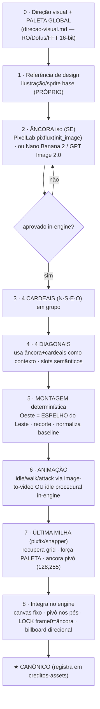

# Pipeline de arte — ecossistema de sprites coeso (IA → engine)

Processo **reproduzível, estagiado e automatizável (API/CLI)** pra criar **todo o ecossistema**
visual com um **estilo GLOBAL consistente** — não só personagens, mas **tiles, props, itens/ícones
e VFX** — usando IA + uma **última-milha determinística** que carrega a coesão.

Baseado no método **staged / anchor-first** (chongdashu / Sanjays2402), nas capacidades da
**PixelLab** e **Retro Diffusion**, e numa pesquisa multi-fonte verificada (23 fontes → 25 claims
checados adversarialmente; ver "Fontes").

> **Regra de IP (inegociável):** personagens/assets são **design PRÓPRIO nosso** (a arte base que o
> usuário fornece/gera é a fonte de design). Estilo (RO/FFT/Dofus/16-bit) é **referência de
> estética**, não cópia. **Nunca** animar/derivar arte ripada de jogo de terceiro (RO/Dofus/
> Octopath/Spriters-Resource) — mesmo que seja só "um teste". Ver [[direcao-visual]] e [[arte-do-usuario-e-nossa]].

---

## A descoberta central da pesquisa

**Nenhum gerador de IA, sozinho, dá coesão de estilo entre muitos assets.** Reviews independentes
avisam literalmente: *"gere dez assets e não parecem feitos pelo mesmo artista — o estilo deriva."*
Por isso a **"última milha" determinística NÃO é opcional — é ela que carrega a coesão.**

Arquitetura em duas camadas:

```
  GERADOR DE LARGURA (IA)                 ÚLTIMA MILHA (determinística, código)
  PixelLab / Retro Diffusion     ──►      pixfix / spritefusion-pixel-snapper
  (personagem, tile, prop, ícone)         (recupera grid · força paleta · ancora pivô)
         dá cobertura                              dá coesão + acabamento
```

### Os 3 controles compartilhados que dão coesão (aplicar em TUDO)
1. **Uma** imagem de **referência de estilo** (até 4 na PixelLab · até 9 na Retro Diffusion).
2. **Uma** **paleta forçada** (Lospec/OKLAB — `target_palette` / `input_palette`).
3. **Uma** **densidade de pixel + pivô fixo** (ex.: pés em `128,255`).

### Os 3 defeitos que a última-milha mata
- **Mixels** — "pixels falsos" (quebram no zoom).
- **Frame bleeding** — recorte ingênuo do grid corta o sprite.
- **Frame drift** — o sprite "desliza/balança" in-game.

---

## Personagens 8-direções: o método ESTAGIADO (confirmado 3-0)

**Turnaround 8-direções em UMA chamada NÃO funciona** — as direções colapsam. O que funciona é
**estagiar e aprovar cada etapa**:

- **Etapa 1 — Âncora iso (SE):** peça UMA reinterpretação isométrica SE e **aprove in-engine** antes
  de seguir. É a referência de identidade de todo o resto.
- **Etapa 2 — 4 cardeais (N/S/E/O) em grupo:** máxima separação → o modelo mantém distintas.
  *Truque:* **Oeste sempre deriva → não brigue, espelhe o Leste no código** ("mirror, don't re-prompt").
- **Etapa 3 — 4 diagonais a partir dos cardeais:** alimente **âncora + folha de cardeais** como
  contexto. **Slots semânticos** batem melhor que bússola:
  `NE = mais costas + lado direito`, `SE = mais frente + lado direito`,
  `NW = mais costas + lado esquerdo`, `SW = mais frente + lado esquerdo`.
- **Etapa 4 — Montagem determinística (código):** recorta cada facing, troca Oeste por Leste
  espelhado, normaliza altura/baseline, monta a folha 8-dir.

### Diagrama de processo (personagem)



---

## Stack de modelos por tipo de asset

**Dois pipelines DISTINTOS** (a pesquisa corrigiu uma confusão nossa — eram tratados como um só):

| Pipeline | Imagem estática | Walk/animação | Obs. |
|---|---|---|---|
| **A — turnaround FFT** (Sanjays2402) | **Nano Banana 2** | **Veo 3.1 Fast** | "consistência > pico de qualidade" (heurística, 2-1) |
| **B — pixel-snapped** (chongdashu) | **GPT Image 2.0** | **WAN 2.0 / SeedDance 2.0** | tudo via fal.ai — **NÃO usa Veo 3.1** |

> ⚠️ **Correção:** o método *pixel-snapped* do chongdashu usa **GPT Image 2.0 + WAN/SeedDance**, não
> Veo 3.1. Veo 3.1 + Nano Banana pertence ao **outro** pipeline (turnaround FFT). Trate os NOMES de
> modelo como **slots trocáveis** (ambos os pipelines suportam swap via fal.ai) — o landscape muda rápido.

### Gerador de largura single-vendor (cobre o ecossistema INTEIRO via REST)

| | **PixelLab** (o que já usamos) | **Retro Diffusion** (alternativa/complemento) |
|---|---|---|
| Personagem 8-dir | `create-character-pro` (grid 3×3, 1 passo) | `rd_advanced_animation__rotate/walking/...` |
| Tiles | `create-tileset` · `create-isometric-tile` | `rd_tile__tileset` (wang 16–32px) |
| Props/objetos | `map-objects` · `create-8-direction-object` | `rd_tile__tile_object` / `scene_object` |
| **Itens/ícones** | *(path separado — NÃO rotear por objeto)* | `rd_core__inventory_items` (retorna atlas JSON) |
| VFX / UI | `vfx` · `generate-ui-v2` (Pro) | — |
| Estilo | até **4** refs + `target_palette` | até **9** refs + `input_palette` · seed · MCP (33 tools) |

**Recomendação pro nosso caso (indie, API/CLI, já na PixelLab):** manter a **PixelLab como gerador
único de largura**, impor estilo via **refs + paleta forçada**, e **bolt-on a última-milha em Rust**
como gate de qualidade. Avaliar Retro Diffusion quando precisar de **ícones de inventário** (path
dedicado) ou de **mais refs de estilo** (9 > 4).

---

## Última milha determinística (o gate de coesão) — tooling

Rust, MIT, automatizável — encaixa no nosso jeito CLI:

- **pixfix** (`lovelaced/pixfix`) — **recomendado pro nosso pipe**: determinístico (mesmo input+seed =
  bytes idênticos), detecta o grid nativo por alinhamento de borda, mata mixels **preservando
  dithering**, remove anti-alias via teste OKLAB, quantiza paleta (K-means OKLAB → Lospec/pico-8/
  sweetie-16), e **emite JSON no stdout** (ideal pra agente/script).
- **spritefusion-pixel-snapper** (`Hugo-Dz/...`) — snap + quantização, **batch** de pastas/arquivos,
  `--palette <HEX,...>`. É o snapper por trás do pipeline Phaser do chongdashu.
- **Pixel Snap** (sorceress.games, hospedado) — bridge **vídeo → spritesheet** (extrai frames do
  vídeo, cura, snapa, monta folha). Útil pro passo image-to-video; é página de vendor (sem verificação
  independente de qualidade).

### Sequência da última milha
`gerar spritesheet → recuperar frames → curar (review alinhado pelos pés) → pixel-snap → ancorar no
pivô compartilhado (pés) → normalizar e montar a folha de runtime`.

---

## Animação mínima / "dar vida" (tirar a estática)

Nem todo asset precisa de walk completo. Pra um sprite não ficar **congelado** no jogo, dois caminhos:

1. **Idle procedural in-engine (mais barato, zero arte nova, zero risco de IP):** no billboard, um
   leve **bob vertical + "respiração"** (escala senoidal sutil) + **sway de capa/cabelo** quando parado.
   Roda em qualquer sprite que já temos legitimamente. É o jeito RO/FFT de "vida" com custo quase nulo.
2. **Idle/animação via image-to-video:** PixelLab `animate` (nativo pixel, cap 64px) ou fal.ai
   (WAN/SeedDance/Veo) a partir de 1 facing → extrai 2–4 frames → cicla no billboard + última milha.

> Comece pelo **(1)** pra validar a sensação de vida in-engine; use **(2)** quando precisar de
> animação de pixel "de verdade" (walk/attack) com qualidade de folha.

---

## Guardrails de consistência (valem sempre)
1. **Âncora única** + **paleta global** como referência de TODAS as etapas e de TODOS os tipos de asset.
2. **Canvas fixo + pivô nos pés** em todo frame (`128,255`) — é o que impede o drift in-game.
3. **Lock do frame 0** = a âncora (idle começa do sprite shipado).
4. **Parar de pedir, começar a codar:** espelho, normalização, recorte, snap e montagem são
   **código** (CLI), não prompt.

---

## Última milha pro nosso engine (gap honesto / questões abertas)
- Os pipelines de referência miram **Phaser 4**; nós somos **Bevy 3D billboard (2.5D)**. Os snappers
  entregam PNG/folha — provável **passo de conversão** pra `TextureAtlas` + convenção de pivô do Bevy.
- **Ninguém testou empiricamente** coesão cross-**tipo** (personagem × tile × ícone) — só cross-direção
  dentro de personagem. Nossa paleta global + snapper forçando paleta é a melhor aposta, mas **validar
  com 1 tile + 1 prop + 1 personagem** antes de produzir em massa.
- Sem números de **custo por-asset** confiáveis (PixelLab credits × RD inferences × fal.ai vídeo).

## Status atual no projeto
- ✅ Âncora do **Lobo** (`assets-review/wolf_16bit_B.png`, 128px) aprovada como canônica.
- ✅ Walk de teste (4× 64px via PixelLab) ligado — prova o pipeline in-engine.
- ⏳ Falta: idle procedural (dar vida) · 8 direções (`/rotate` + montagem) · última-milha (pixfix como
  gate) · decidir walk HD (PixelLab 64px × fal.ai) · paleta global (16 cores) · validação cross-tipo.

## Fontes (pesquisa verificada)
- [Sanjays2402/isometric-sprite-pipeline](https://github.com/Sanjays2402/isometric-sprite-pipeline) — pipeline A (Nano Banana 2 + Veo 3.1)
- [chongdashu/ai-pixel-snapped-game-sprites](https://github.com/chongdashu/ai-pixel-snapped-game-sprites) — pipeline B (GPT Image 2.0 + WAN/SeedDance) + os 3 defeitos
- [chongdashu/ai-game-spritesheets](https://github.com/chongdashu/ai-game-spritesheets)
- [lovelaced/pixfix](https://github.com/lovelaced/pixfix) · [Hugo-Dz/spritefusion-pixel-snapper](https://github.com/Hugo-Dz/spritefusion-pixel-snapper) — última milha
- [PixelLab API](https://www.pixellab.ai/pixellab-api) · [Retro Diffusion API](https://retrodiffusion.ai/app/guide/api)
- [sorceress.games/pixel-snap](https://sorceress.games/pages/pixel-snap) — vídeo→folha
